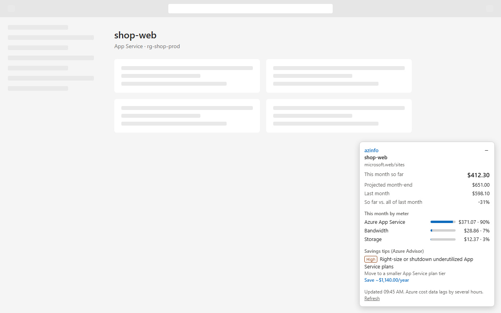

# azinfo

See what an Azure resource costs without leaving the page you're on.

azinfo is a free browser extension for Chrome and Edge. It adds a small panel to the Azure portal
that shows the cost of the resource you're looking at.



## Install

- [Chrome Web Store](https://chromewebstore.google.com/detail/agbbplllbldedlebmjoplcjilocgphia)
- [Microsoft Edge Add-ons](https://microsoftedge.microsoft.com/addons/detail/boklcincembcnlpajejonihmapalfedi)

You need a Microsoft account with access to an Azure subscription, and the **Cost Management
Reader** role (or Reader, Contributor or Owner) on it. If you sign in with a work or school
account, your administrator may need to approve azinfo once:
[how administrators approve it](https://meedruoka.github.io/azinfo/admin-consent.html).

## What it shows

Open any resource in the Azure portal and azinfo shows:

- the cost this month so far, and last month
- this month against the same days of last month, so the 3rd of the month isn't read as a win
- a running total, day by day, of this month over last month
- the projected cost at the end of the month
- a warning when this month looks much higher than last month
- what the cost is made of (compute, storage, bandwidth…)
- Azure Advisor's savings tips, with estimated savings

Open a resource group and you get every resource in it, sorted by cost, and its monthly budget
as a line on the chart when one is set on the group. The toolbar button shows
the five most expensive resources in a subscription.

Choose **actual cost** (what was billed) or **amortized cost** (reservations and savings plans
spread over the resources that use them) on the options page. The panel shows the last figures it
has straight away and refreshes them behind.

Available in 15 languages. Cost figures come from Azure Cost Management, which updates every few
hours.

## Your data

- **No server.** Data goes straight from Microsoft to your browser and stays there.
- **No analytics, tracking or ads.**
- **Read-only.** azinfo never changes anything in Azure.
- **Only what you can already see.** It signs in as you, so it sees only what your Azure roles
  allow.
- **Sign-in tokens are kept in memory only** and are gone when you close the browser.

Read the full [privacy policy](https://meedruoka.github.io/azinfo/privacy-policy.html).

## Checking the code yourself

You don't have to take the points above on trust. Here's where to look.

**Every network call.** The extension only talks to Microsoft:

| Address | Why | Code |
|---|---|---|
| `login.microsoftonline.com` | Signing in | [lib/auth/](lib/auth/) |
| `management.azure.com` | Reading subscriptions, costs and Advisor tips | [lib/azure/](lib/azure/) |

`grep -rn "fetch(" lib entrypoints` lists every request in the code. On `portal.azure.com` it
only reads the page address, to know which resource you're viewing
([lib/portal/parse-portal-url.ts](lib/portal/parse-portal-url.ts)). It doesn't read the page
content, cookies or the portal's own sign-in.

**Browser permissions.** Only `identity` (to sign in) and `storage` (settings and cached costs),
plus access to the three addresses above. No access to other sites, your tabs or your browsing.
No code is loaded from the internet: everything is in the package. Each permission is explained in
[docs/permissions.md](docs/permissions.md).

**Where to start reading:**

| Path | What's there |
|---|---|
| [entrypoints/background.ts](entrypoints/background.ts) | The core of the extension: handles every request |
| [lib/sender-policy.ts](lib/sender-policy.ts) | What the panel inside the portal is allowed to ask for |
| [entrypoints/content/](entrypoints/content/) | The panel you see in the portal |
| [entrypoints/popup/](entrypoints/popup/), [entrypoints/options/](entrypoints/options/) | The toolbar popup and the settings page |
| [docs/decisions/](docs/decisions/) | Why things are built the way they are |

**How updates are made.** Every change is checked automatically (tests, and a check that the
extension asks for no extra permissions). Packages are built by
[GitHub Actions](.github/workflows/) from this repository, not on a personal computer, and each
store reviews every update before it reaches you.

### Verify a release

Each version sent to the stores is also published on the
[Releases page](https://github.com/meedruoka/azinfo/releases), with the exact Chrome and Edge
packages and their SHA-256 checksums. GitHub signs a record of how each package was built
(an [artifact attestation](https://docs.github.com/en/actions/how-tos/secure-your-work/use-artifact-attestations/use-artifact-attestations)),
so you can check that it came from this repository's release workflow and wasn't changed
afterwards:

```sh
gh attestation verify azinfo-<version>-chrome.zip -R meedruoka/azinfo
```

The output names the commit it was built from, so you can read the code of that exact version.

### Compare with your installed copy

The stores re-sign what they serve and add a few things of their own (the `_metadata/` folder,
and `update_url` and `key` in `manifest.json`). To check that the copy your browser installed is
the release package:

1. Download the release zip for your browser and its version, and unzip it.
2. Find the installed folder. Open `chrome://version` (or `edge://version`) and copy the
   **Profile Path**. The extension is in `Extensions/<extension ID>/<version>_0` under it. The ID
   is on `chrome://extensions` (or `edge://extensions`) with developer mode on.
3. Compare them:

```sh
node scripts/compare-builds.mjs <unzipped release folder> <installed extension folder>
```

It prints `Identical` when every file matches, leaving out only what the stores add, and lists
any file that differs otherwise.

## Build it from source

You need Node.js 24 and pnpm.

```sh
pnpm install
pnpm test
pnpm build        # Chrome, in .output/chrome-mv3
pnpm build:edge   # Edge, in .output/edge-mv3
```

Load the output folder with **Load unpacked** on `chrome://extensions` or `edge://extensions`
(turn on developer mode first). To sign in from your own build you need your own Microsoft Entra
app registration: see [docs/entra-setup.md](docs/entra-setup.md). More detail is in
[docs/development.md](docs/development.md).

## Questions and problems

- Bugs, ideas and questions: [open an issue](https://github.com/meedruoka/azinfo/issues).
- Security problems: please
  [report them privately](https://github.com/meedruoka/azinfo/security/advisories/new) instead of
  in a public issue.

azinfo is an independent project. It isn't affiliated with or endorsed by Microsoft.
